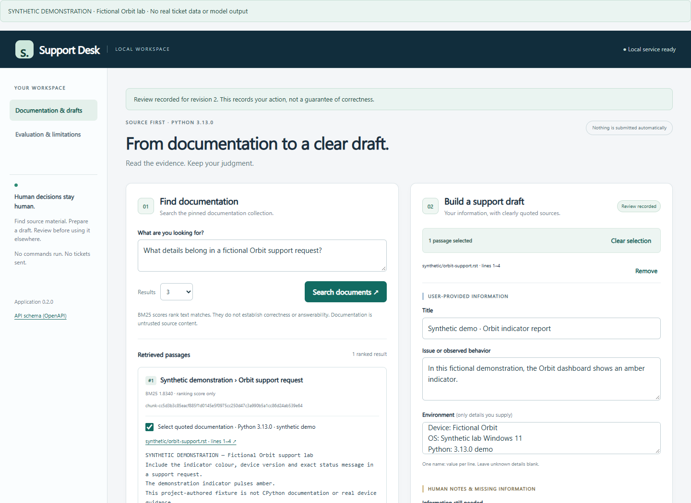

# Support Document Assistant

**Find relevant documentation and prepare a support draft with linked sources.**

Support Document Assistant is a local workspace for people asking for or handling Python environment and package-installation questions. It helps a user find documentation, connect selected passages to a reported problem, and prepare a draft for human review.

## Motivation

A useful support request brings together several pieces of information: what went wrong, the environment in which it happened, what is still unknown, and the documentation relevant to the problem. Keeping user observations separate from documentation quotations makes the basis of the request easier to inspect.

The project originally set out to build a retrieval-augmented generation (RAG) assistant: a user would ask a question, the system would retrieve relevant documentation, and a local language model would answer with supporting citations. The evaluation also tested whether the system could recognise when the documents did not contain enough information to answer.

Testing exposed important limitations. The candidate sometimes produced incorrect or incomplete answers, selected irrelevant citations, or made unsupported claims while labelling its response `insufficient_evidence`. These findings shaped the application: generation remains optional and experimental, while the default workflow lets a person inspect the original passages and decide what to include in a support draft. The [research findings below](#research-findings-including-failures) retain the measured failures and their limitations.

The motivation is therefore both practical and investigative: provide a workspace for assembling a documented support request, and demonstrate how evaluation results inform the design and limits of an application using a language model.

## Example: from a problem to a support draft

A user is working on two Python projects that need different package versions and wants help keeping them separate.

1. **Describe the problem** in ordinary language and search the documentation.
2. **Read the retrieved passages** and inspect their source links and Python version.
3. **Select useful quotations** and add the observed issue, environment details and questions that still need answering.
4. **Edit and review the saved draft**, then copy it into an email, helpdesk ticket or other support channel.

**The final output is a saved support-ticket draft containing the user's report, selected documentation quotations, source links and review state.** The sources can also be read directly without creating a draft. Sending the request and making changes to a computer remain manual actions.

## Scope and implementation

The demonstration searches **four pinned CPython 3.13.0 documentation files** covering virtual environments, `ensurepip` and package installation. Its usefulness is limited to that collection; it is not a general search engine or a complete Python support knowledge base.

The workspace is built with FastAPI, plain HTML/CSS/JavaScript and SQLite. Its engineering focus includes source provenance, retrieval and answer evaluation, revision-based review, API testing, Docker packaging and CI.

The default workflow is model-free. A separate Windows-only Qwen3 endpoint is experimental, explicitly enabled and always unverified. Model output is never automatically inserted into a draft or approved.

[Mobile layout](docs/images/mobile-workflow.png) · [Reviewed synthetic revision](docs/images/reviewed-revision.png) · [Evaluation view](docs/images/evaluation-limitations.png)

These are actual browser captures with project-authored fictional Orbit data. The review event demonstrates application state, not human answer-quality approval. No model output is shown.

## Run locally

Requires 64-bit Python 3.13. From this checkout in PowerShell:

~~~powershell
python -m venv .venv
.\.venv\Scripts\python.exe -m pip install setuptools==78.1.0
.\.venv\Scripts\python.exe -m pip install -r application/requirements-runtime.txt
.\.venv\Scripts\python.exe -m pip install --no-deps --no-build-isolation -e application
.\.venv\Scripts\python.exe -m support_api
~~~

Open **http://127.0.0.1:8010/**. One worker, loopback only. Stop with Ctrl+C. This publication launcher loads the unchanged packaged corpus; it does not need the original research checkout. Drafts live in ignored application/.app-data/tickets.sqlite3.

## Run with Docker

Requires a running Linux Docker engine:

~~~powershell
docker compose up --build -d
# Open http://127.0.0.1:8010/
docker compose down
~~~

The named SQLite volume survives down and container recreation. The container runs non-root, with a read-only filesystem and host-loopback port publication. It includes no model weights, ML libraries, Windows runtime, benchmark references or final responses. **Experimental generation is unsupported on Linux.**

[Setup and verification](docs/setup.md) · [API reference](docs/api.md) · [Architecture](docs/architecture.md)

## What the workflow does

- Search returns ranked parent chunks and complete mapped blocks, with pinned links, Python version and line references. Scores rank text matches; they do not establish truth.
- Select passages for a deterministic draft. Only user-supplied environment details and validated corpus IDs are accepted.
- Edit using the current revision. Every edit creates a revision and invalidates earlier review. Stale edits/reviews are rejected.
- Explicitly review the saved current revision. Copying includes its revision and review state. Review records a local action, not authenticated identity or guaranteed correctness.
- Model output is never automatically inserted into a draft or approved.

## Research findings, including failures

The saved one-time diagnostic assessed the frozen **BM25 top-3 + v2 packing/prompt + Qwen3-4B Q4_K_M** candidate. It did not evaluate this API, UI or ticket workflow.

| Saved ordinary result | Denominator / meaning |
|---|---|
| Correctness **3/6** | Six answerable variants in three related families; frozen 0/0.5/1 rubric |
| Family-macro Recall@5 **2/3** | Variants averaged within family, then equal family weights; pooled required claims 4/7 |
| Successful abstention **0/4** | Four negative variants in two families; both negative cases failed |
| Primary citation precision/completeness **N/A** | Incomplete atomic annotations; no target pass can be claimed |
| Application acceptance **20/20** | Structure/citation eligibility across ordinary and controls, not semantic correctness |

Ten ordinary responses and ten separately labelled controls were saved. T06 ordinary contexts were excluded because their expected behavior was undefined. The owner authorized this diagnostic despite failed development safety prerequisites, and one quality attempt per context instead of three timing repetitions. Original targets were not lowered.

The small related families and locally visible holdout limit generalization. **The final assessment is consumed.** These records are for inspection, not another benchmark pass or permission to tune against final questions. Unassigned judgments remain unassigned; controls stay separate.

**T01 caveat:** the supplied activation table contains the requested fact, although it fails the broader frozen source-span proxy. Primary retrieval/packing scores remain unchanged.

A valid citation may be irrelevant, an accepted answer may contradict evidence, and insufficient_evidence text may contain an unsupported answer. Saved failures include a reversed pip default, a missing opt-out answer, a minimum-version/exact-version confusion and unsuccessful negative responses. Generation stays optional.

[Evaluation and limitations](docs/evaluation.md) · [Exact saved responses and human review](docs/saved-evidence.md) · [Evidence provenance](docs/curation.md)

## Optional Windows generation

The existing adapter uses pinned official Qwen3-4B Q4_K_M, a pinned llama.cpp Windows CPU runtime and the official non-thinking template. It requires separately supplied verified artifacts and tokenizer metadata. No weights or runtime binaries are included. It is disabled without --experimental.

Historical ordinary HTTP timings were n=10, median 47.578s; native peak RAM was about 6.793 GiB, separately scoped from Python. The GGUF is about 2.50 GB. These are research measurements, not API guarantees. The prompt/schema limit mismatch remains documented and unchanged.

[Exact requirements and limits](docs/experimental-windows.md). No real-model call was made during publication preparation. Default search/drafting works without those artifacts.

## Engineering checks and status

Synthetic API, UI and Docker checks verify integration and provenance, not answer quality. CI uses pinned Actions identities and minimal permissions; **hosted Actions has passed**, including the synthetic browser and default container workflows. See the [workflow runs](https://github.com/tanjilaislam414659/support-document-assistant/actions/workflows/application.yml). These checks do not measure answer quality.

[Application verification](docs/verification.md) · [Prepared v0.2.0 release notes](RELEASE_NOTES.md) · [Portfolio walkthrough](docs/portfolio.md)

This publication uses curated source and fresh history. Original development history and research artifacts remain preserved locally. Code license: **MIT, copyright 2026 Tanjila Islam**; see [LICENSE](LICENSE) and [license status](LICENSE-STATUS.md), [third-party attribution](THIRD_PARTY.md) and [public authorship/AI assistance](AUTHORS.md).
